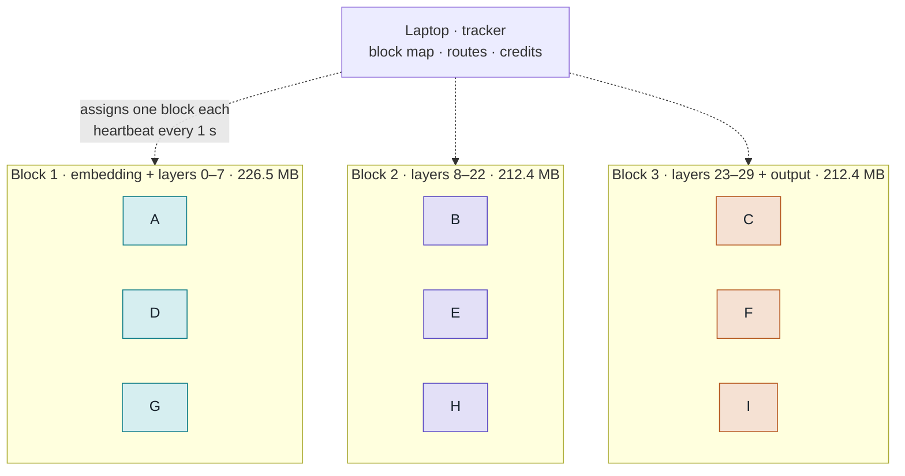
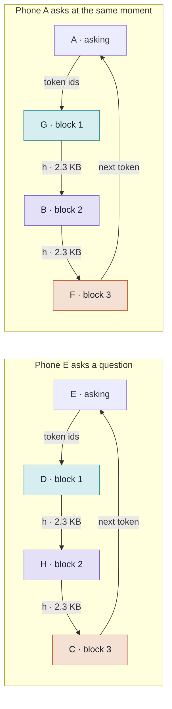
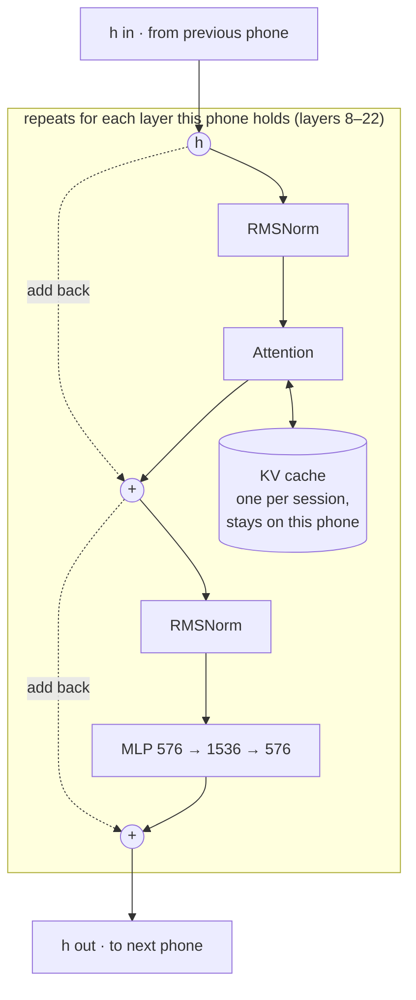
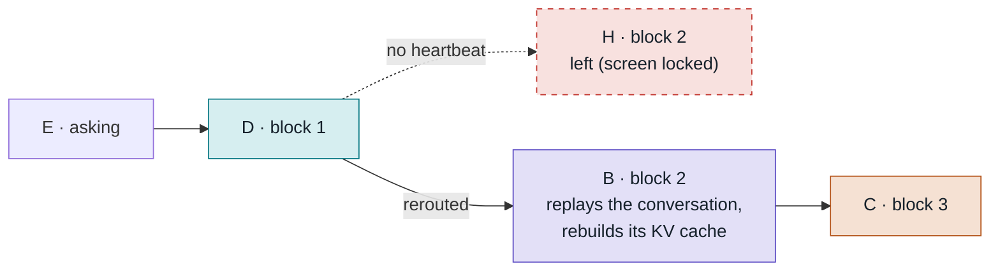

# Phone Swarm Inference

Every phone on our Wi-Fi lends compute and can use it, like a torrent. We cut
the model into three blocks of layers. Each phone holds one block, and every
question travels through one holder of each block.

| | |
|---|---|
| Model | SmolLM2-135M-Instruct, 30 layers |
| Whole model | 538 MB (float32) |
| Budget per phone | 300 MB (one browser tab) |
| Sent per hop | 576 numbers ≈ 2.3 KB per token |

## The swarm

The laptop runs the **tracker**. When a phone joins, the tracker gives it a
block, and the phone downloads only that block's weights. The whole model is
over the 300 MB we allow one browser tab, so no single phone could run it
alone. The first phones make one whole path, the next ones back up every
block, and after that more phones split the slowest block in two
([rebalancing](#rebalancing)).



Nine phones, three blocks, three holders each (with `--min-replica 3`). Every
phone also has a chat box, so the phones serving blocks are the same ones
asking questions.

## How a question travels



The tracker picks, for each block, the holder that should deliver tokens
soonest: its measured time per token, shared with the answers it is already
generating. So both questions run at once on different phones, and slow
phones are passed over. E also holds block 2 and keeps serving other
people while it asks. In v1 the laptop relays every hop over WebSocket; later,
phones send to each other directly.

1. **E** types a question. Its tokenizer turns the text into token ids.
2. The tracker picks a route: the fastest available holder of each block, here **D**, **H** and **C**.
3. **D** looks up the embedding for every token of the question at once, runs layers 0–7, and sends h on.
4. **H** runs layers 8–22 and sends h on.
5. **C** runs layers 23–29, then the output layer, which picks the next token.
6. **E** shows the token and sends it back through the same route. Each phone
   on the route keeps a KV cache for E's session, so after the first pass only
   the one new token travels, never the whole conversation.
7. The session lasts the whole conversation. When E asks a follow-up, the
   same route still holds the KV caches, so only the new question's tokens
   travel.

## What runs on one phone

Every phone does two jobs at the same time. Here is phone E, which holds block 2.

### Serving its block, for anyone



Block 1 starts by turning token ids into h with an embedding lookup. Block 3
ends with a final RMSNorm and the output layer, which scores all 49,152 tokens
and sends back the best one.

### Asking, for the person holding it

- A chat box to type a question and watch the answer appear token by token.
- The tokenizer, about 2 MB. Asking needs no model download.
- A credit balance that goes up when the phone serves and down when it asks.
- Questions leave as token ids and answers come back as token ids, one per pass.

Serving runs in a Web Worker, so the chat stays responsive while the phone
computes for others.

## The three blocks

| Block | Holds | Weights | Compute per token | Extra job |
|---|---|---|---|---|
| 1 | embedding + layers 0–7 | 226.5 MB | 8 layers | token ids → h |
| 2 | layers 8–22 | 212.4 MB | 15 layers | none |
| 3 | layers 23–29 + output | 212.4 MB | 15 layers | h → next token |

Blocks 1 and 3 both carry the 113 MB embedding table, because the model reuses
it as its output layer, so they get fewer layers. The tracker cuts the layers
this way by itself, balancing memory (`--min-blocks 3`). Each phone also keeps
a KV cache for every active session: about 1.5 KB per token per layer, so a
1,000-token chat takes about 23 MB on block 2. Sizes are float32 for v1.
Switching to int8 later cuts the weights to a quarter.

## Rebalancing

Phones come and go, so the tracker keeps reshaping the blocks, with two
settings: `--min-blocks` (3) and `--min-replica` (2). A joining phone goes:

1. to a block nobody holds, until there is one whole path of `min-blocks` blocks;
2. else to a block with fewer than `min-replica` phones, so a phone leaving doesn't cut answers;
3. else to the block with the most compute, as one more replica. The phone that
   brings it to 2 × `min-replica` splits it in two at its compute midpoint
   instead: `min-replica` phones per half, so each token costs each phone less.

| Phones | Blocks (phones on each) |
|---|---|
| 3 | 0–7 (1) · 8–22 (1) · 23–29 + output (1) |
| 6 | 0–7 (2) · 8–22 (2) · 23–29 + output (2) |
| 7 | 0–7 (2) · 8–22 (**3**) · 23–29 + output (2) |
| 8 | 0–7 (2) · **8–14 (2) · 15–22 (2)** · 23–29 + output (2) |
| 10 | 0–7 (2) · 8–14 (2) · 15–22 (2) · **23–28 (2) · 29 + output (2)** |

The output layer counts as 8 layers of compute, so block 3 is as slow as
block 2 despite having fewer layers. Phones on a block that splits already
have both halves' weights, so they reload from their own cache and only the
new phone downloads anything. When a phone leaves, a block nobody holds takes
a phone from the block with the most, and a block below `min-replica` takes
one from a block above it. Answers through moved phones are rerouted and stay
exactly right.

## When a phone leaves

Phones lock their screens, run out of battery, or walk away. The tracker
expects a heartbeat from every phone each second and keeps at least two
holders per block.



H stops answering, so the tracker sends E's question through B, another
holder of block 2. E replays the conversation so far through the new route
as one prefill, so B (and D and C) rebuild their KV caches, and the answer
continues without starting over.

## Credits

One credit pays for running one layer on one token. A generated token costs
the asker 38 credits, paid to the three phones that did the work:

**block 1: 8 + block 2: 14 + block 3: 16 = 38 credits per token**

Block 3 earns 16 because the output layer costs about as much as 8 layers.
New phones start with a small balance so they can ask right away. In v1 the
tracker keeps the balances. Moving them on-chain comes later and is the
ETHGlobal piece.

## Design rules

- **Few, big blocks.** Every hop adds about 10–20 ms of Wi-Fi delay, so we use as few blocks as fit in memory.
- **Only h moves.** A hop carries 576 numbers per token. Weights and KV caches stay on their phones.
- **Two or more holders per block,** so one phone leaving never stops a question.
- **Phones are equals.** Each one serves a block and can ask. The laptop coordinates and, in v1, relays traffic.
- **Our own thin protocol, no libp2p.** On one Wi-Fi with a tracker, libp2p's discovery and NAT traversal buy nothing. Messages are a small binary header plus raw float32 bytes, sent behind one transport interface so the transport can be swapped later.

## Build order

| Step | What | Status |
|---|---|---|
| 1 | **Python reference.** Export the weights as blocks, write a NumPy stage engine, and prove that split runs give exactly the same tokens as the unsplit model. | Done: 17/17 checks. Matches Hugging Face, and every split is bit-identical. [reference/](reference/README.md) |
| 2 | **JS engine in Node.** Port the stage to JavaScript and check it against step 1's test vectors. | Done: 16/16 checks. Matches Python to about 1e-6, 30 ms per token on a laptop with the WASM kernels (130 ms in plain JS). [engine/](engine/README.md) |
| 3 | **Swarm in browser tabs.** Tracker, routes and sessions, with several tabs on one laptop standing in for phones. The output must match Hugging Face token for token. | Done: 45/45 checks. 40 of 40 tokens through the swarm, and h on the wire is bit-identical to step 2. Speed-aware routing, and conversations that keep their KV caches between questions. [swarm/](swarm/README.md) |
| 3.5 | **Mock phones as containers.** Each phone is a Docker container running Chromium, behind HTTPS, with Wi-Fi delay and loss, frozen phones, killed phones and slow phones. | Done: 16/16 scenarios. Wi-Fi adds about 70 ms per token; a frozen phone is dropped after 5 s. [docker/](docker/README.md) |
| 4 | **Real phones.** HTTPS, screen wake lock, weights cached in the browser, phones that stay reachable while they compute, then faster WASM kernels with int8 weights. | Real phones answered over a Cloudflare tunnel and on the LAN. Wake lock, weight cache and busy-aware heartbeat done: 17/17 container checks. WASM SIMD matmul kernels done: 4× faster per token, 12× faster on the prompt. [engine/](engine/README.md#speed) [swarm/](swarm/README.md#real-phones) |
| 5 | **Credits, recovery, dashboard.** Credit balances, rerouting when a phone leaves, rebalancing blocks, and a live view of the swarm. | Rerouting, rebalancing (a whole path, then replicas, then splitting the slowest block), the dashboard (`/dashboard`) and the management view (`/manage`) done. Credits next. |

After the MVP:

- Phones send h to each other directly over WebRTC data channels instead of through the laptop, with the tracker doing the signaling.
- Revisit libp2p only if the swarm goes over the internet without a tracker (DHT discovery, NAT traversal).
- Catch bad results by re-running a random step on a second phone and
  comparing hashes. The WASM kernels give identical results on every phone,
  so honest phones always match.
- Credits on-chain.
- Torrent-style weight sharing: a new phone downloads its block from phones that already have it.

## Two models: the big one and the backup

The swarm runs any Llama-architecture model from Hugging Face that
`reference/export.py` accepts (RMSNorm, RoPE, GQA, SiLU MLP, no biases, a
byte-level BPE tokenizer with a ChatML chat template). Two are set up:

| | MiniCPM5-2B (the demo) | SmolLM2-135M (the backup) |
|---|---|---|
| Model | `openbmb/MiniCPM5-2B`, Sep 2026, Apache-2.0, 2B-class SOTA | `HuggingFaceTB/SmolLM2-135M-Instruct` |
| Parameters | 2.52B, 42 layers, hidden 2048, 16 Q / 2 KV heads | 135M, 30 layers, hidden 576 |
| Weights on phones | int8, 2.5 GB in all: 47 MB per layer, 268 MB embedding, 268 MB output layer | float32, 538 MB |
| `npm start` | 6 blocks: 315–472 MB per phone, two holders each at 12 phones | |
| `npm run start:3phones` | 3 blocks: 928 · 944 · 645 MB per phone, no spare holders | |
| `npm run start:small` | | 3 blocks of about 200 MB, as before |
| Sent per hop | 2048 numbers ≈ 8 KB per token | 576 numbers ≈ 2.3 KB |
| Checks | float32 export equals Hugging Face: 17/17, 40 of 40 greedy tokens. int8 vs float32: see below | 17/17, 16/16, 35/35 |

MiniCPM5-2B is a hybrid-thinking model; the swarm runs it with thinking off
(the chat template's `<think>\n\n</think>\n\n` prefix, written into the
manifest by `export.py`), so answers start right away. Any other flag still
passes through: `npm start -- --port 8443 --tls-cert … --public-url …`.

Per token, a question costs the same compute whichever way the model is cut
(blocks run one after another), so three phones are no slower than six, only
heavier: each has to hold a 650–950 MB block in one tab. Six is the safe
default; `--min-blocks` and `--min-replica` are the knobs.

## Run what exists so far

```sh
python3 -m venv .venv
.venv/bin/pip install -r reference/requirements.txt

# The backup model, SmolLM2-135M
.venv/bin/python reference/export.py   # writes weights/smollm2-135m-instruct/ (538 MB)
.venv/bin/python reference/check.py    # step 1 checks, writes testvectors/
.venv/bin/python reference/tokenizer_vectors.py
(cd engine && npm run check)           # step 2 checks
cd swarm && npm install
npm run check                          # step 3 checks (Node 22+)
npm run start:small                    # then open http://localhost:8080 in 3+ tabs,
                                       # and /dashboard or /manage on the laptop
cd ../docker && npm install && npm test   # step 3.5: phones as containers (Docker)

# The demo model, MiniCPM5-2B (5 GB download, 10 GB float32 + 2.5 GB int8 on disk, 24 GB RAM)
.venv/bin/python reference/export.py --model openbmb/MiniCPM5-2B
.venv/bin/python reference/export.py --model openbmb/MiniCPM5-2B --dtype int8
.venv/bin/python reference/check.py --weights weights/minicpm5-2b --testvectors testvectors-minicpm5-2b
.venv/bin/python reference/check_int8.py --weights weights/minicpm5-2b-int8 --float32 weights/minicpm5-2b \
    --testvectors testvectors-minicpm5-2b-int8
.venv/bin/python reference/tokenizer_vectors.py --weights weights/minicpm5-2b-int8 \
    --out testvectors-minicpm5-2b-int8/tokenizer.json
(cd engine && npm run check:big)
cd swarm && npm run check:big
npm start                              # 6 blocks; or npm run start:3phones
```

`weights/` and `testvectors*/` are generated and not committed.

### int8 weights

`reference/export.py --dtype int8` stores every matrix as int8 with one
float32 scale per row (the same round-to-nearest family as llama.cpp's
`Q8_0`). `reference/check_int8.py` compares it with the float32 export and
writes test vectors for the JS engine.

For SmolLM2-135M it is not good enough: on longer questions it picks
float32's next token 194 times out of 198, but on short chats like "hi" it
never emits `<|im_end|>` and repeats itself. MiniCPM5-2B is the model it was
groundwork for; `npm run start:small` keeps the 135M in float32.
