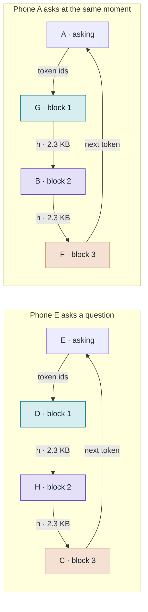
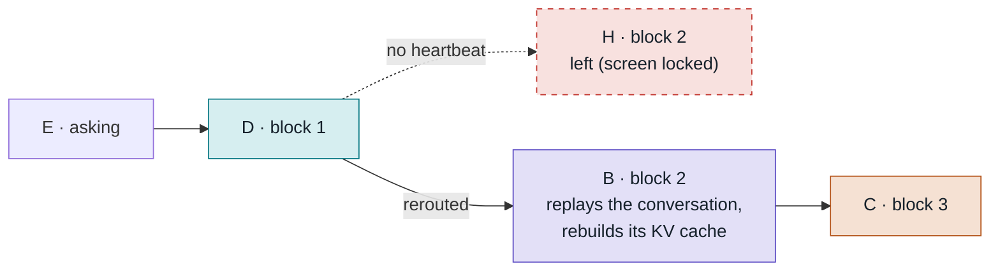

# Phone Swarm Inference

Every phone on our Wi-Fi lends compute and can use it, like a torrent. We cut
the model into three blocks of layers. Each phone holds one block, and every
question travels through one holder of each block.

| | |
|---|---|
| Model | SmolLM2-135M-Instruct, 30 layers |
| Whole model | 538 MB (float32) |
| Budget per phone | 300 MB (one browser tab) |
| Sent per hop | 576 numbers ≈ 2.3 KB per token |

## The swarm

The laptop runs the **tracker**. When a phone joins, the tracker gives it the
block with the fewest holders, and the phone downloads only that block's
weights. The whole model is over the 300 MB we allow one browser tab, so no
single phone could run it alone.


Nine phones, three blocks, three holders each. Every phone also has a chat
box, so the phones serving blocks are the same ones asking questions.

## How a question travels



The tracker picks the least-busy holder of each block, so both questions run
at once on different phones. E also holds block 2 and keeps serving other
people while it asks. In v1 the laptop relays every hop over WebSocket; later,
phones send to each other directly.

1. **E** types a question. Its tokenizer turns the text into token ids.
2. The tracker picks a route: the least-busy holder of each block, here **D**, **H** and **C**.
3. **D** looks up the embedding for every token of the question at once, runs layers 0–7, and sends h on.
4. **H** runs layers 8–21 and sends h on.
5. **C** runs layers 22–29, then the output layer, which picks the next token.
6. **E** shows the token and sends it back through the same route. Each phone
   on the route keeps a KV cache for E's session, so after the first pass only
   the one new token travels, never the whole conversation.

## What runs on one phone

Every phone does two jobs at the same time. Here is phone E, which holds block 2.

### Serving its block, for anyone


Block 1 starts by turning token ids into h with an embedding lookup. Block 3
ends with a final RMSNorm and the output layer, which scores all 49,152 tokens
and sends back the best one.

### Asking, for the person holding it

- A chat box to type a question and watch the answer appear token by token.
- The tokenizer, about 2 MB. Asking needs no model download.
- A credit balance that goes up when the phone serves and down when it asks.
- Questions leave as token ids and answers come back as token ids, one per pass.

Serving runs in a Web Worker, so the chat stays responsive while the phone
computes for others.

## The three blocks

| Block | Holds | Weights | Extra job |
|---|---|---|---|
| 1 | embedding + layers 0–7 | 226.5 MB | token ids → h |
| 2 | layers 8–21 | 198.2 MB | none |
| 3 | layers 22–29 + output | 226.5 MB | h → next token |

Blocks 1 and 3 both carry the 113 MB embedding table, because the model reuses
it as its output layer, so they get fewer layers. Each phone also keeps a KV
cache for every active session: about 1.5 KB per token per layer, so a
1,000-token chat takes about 21 MB on block 2. Sizes are float32 for v1.
Switching to int8 later cuts the weights to a quarter.

## When a phone leaves

Phones lock their screens, run out of battery, or walk away. The tracker
expects a heartbeat from every phone each second and keeps at least two
holders per block.



H stops answering, so the tracker sends E's question through B, another
holder of block 2. E replays the conversation so far through the new route
as one prefill, so B (and D and C) rebuild their KV caches, and the answer
continues without starting over.

## Credits

One credit pays for running one layer on one token. A generated token costs
the asker 38 credits, paid to the three phones that did the work:

**block 1: 8 + block 2: 14 + block 3: 16 = 38 credits per token**

Block 3 earns 16 because the output layer costs about as much as 8 layers.
New phones start with a small balance so they can ask right away. In v1 the
tracker keeps the balances. Moving them on-chain comes later and is the
ETHGlobal piece.

## Design rules

- **Few, big blocks.** Every hop adds about 10–20 ms of Wi-Fi delay, so we use as few blocks as fit in memory.
- **Only h moves.** A hop carries 576 numbers per token. Weights and KV caches stay on their phones.
- **Two or more holders per block,** so one phone leaving never stops a question.
- **Phones are equals.** Each one serves a block and can ask. The laptop coordinates and, in v1, relays traffic.
- **Our own thin protocol, no libp2p.** On one Wi-Fi with a tracker, libp2p's discovery and NAT traversal buy nothing. Messages are a small binary header plus raw float32 bytes, sent behind one transport interface so the transport can be swapped later.

## Build order

| Step | What | Status |
|---|---|---|
| 1 | **Python reference.** Export the weights as blocks, write a NumPy stage engine, and prove that split runs give exactly the same tokens as the unsplit model. | Done: 17/17 checks. Matches Hugging Face, and every split is bit-identical. [reference/](reference/README.md) |
| 2 | **JS engine in Node.** Port the stage to JavaScript and check it against step 1's test vectors. | Done: 15/15 checks. Matches Python to about 1e-6, 130 ms per token on a laptop. [engine/](engine/README.md) |
| 3 | **Swarm in browser tabs.** Tracker, routes and sessions, with several tabs on one laptop standing in for phones. The output must match Hugging Face token for token. | Done: 21/21 checks. 40 of 40 tokens through the swarm, and h on the wire is bit-identical to step 2. [swarm/](swarm/README.md) |
| 3.5 | **Mock phones as containers.** Each phone is a Docker container running Chromium, behind HTTPS, with Wi-Fi delay and loss, frozen phones, killed phones and slow phones. | Done: 16/16 scenarios. Wi-Fi adds about 70 ms per token; a frozen phone is dropped after 5 s. [docker/](docker/README.md) |
| 4 | **Real phones.** HTTPS, screen wake lock, weights cached in the browser, phones that stay reachable while they compute, then faster WASM kernels with int8 weights. | Real phones answered over a Cloudflare tunnel and on the LAN. Wake lock, weight cache and busy-aware heartbeat done: 28/28 swarm checks, 17/17 container checks. int8 weights done (a quarter of the download, see below). WASM kernels next. [swarm/](swarm/README.md#real-phones) |
| 5 | **Credits, recovery, dashboard.** Credit balances, rerouting when a phone leaves, rebalancing blocks, and a live view of the swarm. | Rerouting, the dashboard (`/dashboard`) and the management view (`/manage`) done. Rebalancing and credits next. |

After the MVP:

- Phones send h to each other directly over WebRTC data channels instead of through the laptop, with the tracker doing the signaling.
- Revisit libp2p only if the swarm goes over the internet without a tracker (DHT discovery, NAT traversal).
- Catch bad results by re-running a random step on a second phone and
  comparing hashes. The WASM kernels give identical results on every phone,
  so honest phones always match.
- Credits on-chain.
- Torrent-style weight sharing: a new phone downloads its block from phones that already have it.

## Run what exists so far

```sh
python3 -m venv .venv
.venv/bin/pip install -r reference/requirements.txt
.venv/bin/python reference/export.py               # float32 weights/ (538 MB), the ground truth
.venv/bin/python reference/check.py                # step 1 checks, writes testvectors/
.venv/bin/python reference/export.py --dtype int8  # int8 weights (135 MB), what phones get
.venv/bin/python reference/check_int8.py           # int8 vs float32, writes testvectors-int8/
.venv/bin/python reference/tokenizer_vectors.py
(cd engine && npm run check && npm run check:int8) # step 2 checks, both exports
cd swarm && npm install
npm run check                          # step 3 checks on int8 (Node 22+); check:float32 for float32
npm start                              # int8; then open http://localhost:8080 in 3+ tabs,
                                       # and /dashboard or /manage on the laptop
cd ../docker && npm install && npm test   # step 3.5: phones as containers (Docker)
```

`weights/`, `testvectors/` and `testvectors-int8/` are generated and not committed.

### int8 weights: a quarter of the download

The tracker serves int8 by default: every matrix stored as int8 with one
float32 scale per row. Phones download 57 MB for blocks 1 and 3 and 50 MB for
block 2, instead of 226 and 198 MB, and hold them as int8 in memory too.
`npm run start:float32` (or `--weights ../weights/smollm2-135m-instruct`)
serves float32 instead.

int8 is no longer Hugging Face's answer token for token. Fed the float32
answers, it picks the same next token 194 times out of 198 (mean KL 0.0036),
and answers stay sensible, but a near-tie can flip and the text drifts from
there. Splitting still changes nothing: every split of the int8 model is
bit-identical to the unsplit int8 model.
