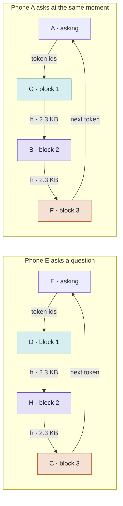
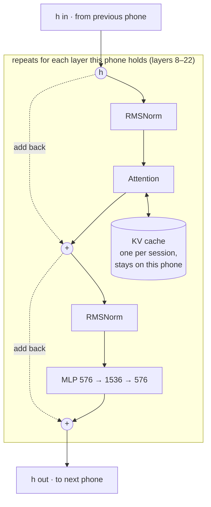
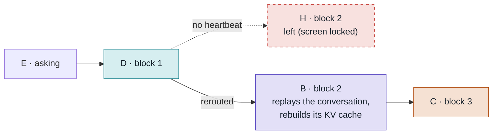
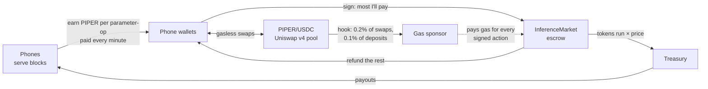

# PiedPiper - Private Decentralized LLM Inference Using Low Powered Devices

Any device can join the network, from a browser tab with no install, and lend
its spare compute to run a large language model for the whole swarm. No single
device holds the model: it is cut into **blocks** of consecutive layers, each
device holds one block, and every question travels through one holder of each
block, like a torrent for inference.

Devices earn **PIPER** for the compute they provide and spend it to ask. PIPER
trades against USDC in a Uniswap v4 pool, so the price of inference is set by a
market. A gas sponsor pays every transaction, so a phone only ever signs and
never needs ETH. The result is plug and play: open a link, and your phone is
serving a 2-billion-parameter model and earning for it.

**Live:** https://34.131.96.166.sslip.io (open it on a phone to join) ·
[dashboard](https://34.131.96.166.sslip.io/dashboard) ·
[pool](https://34.131.96.166.sslip.io/pool) ·
[open dataset](https://34.131.96.166.sslip.io/arkiv)

---

## Contents

- [Features](#features)
- [How it works](#how-it-works)
- [Many devices, many questions at once](#many-devices-many-questions-at-once)
- [How a question travels](#how-a-question-travels)
- [What runs on one phone](#what-runs-on-one-phone)
- [Rebalancing](#rebalancing)
- [Fail-safe mechanisms](#fail-safe-mechanisms)
- [The PIPER economy](#the-piper-economy)
- [Open data on Arkiv](#open-data-on-arkiv)
- [Privacy](#privacy)
- [Run it](#run-it)
- [Deployment](#deployment)
- [Project layout](#project-layout)
- [Verified](#verified)
- [Not yet](#not-yet)

---

## Features

|                                |                                                                                                                                                                                           |
| ------------------------------ | ----------------------------------------------------------------------------------------------------------------------------------------------------------------------------------------- |
| **No install**                 | A phone joins by opening a web page. Its block runs in a Web Worker with WASM SIMD kernels, so the chat stays responsive while it computes for others.                                    |
| **Runs on low-memory devices** | MiniCPM5-2B (int8) is cut into 6 blocks of 315–473 MB, so no device needs more than about half a gigabyte of weights.                                                                     |
| **Exact answers**              | Greedy decoding through the swarm gives the same tokens as Hugging Face, however the model is cut or rerouted. Every hidden state sent between phones is bit-identical to an unsplit run. |
| **Self-organising swarm**      | The tracker assigns blocks as devices join, adds replicas, splits slow blocks, and repairs gaps when devices leave.                                                                       |
| **Concurrent answers**         | Many questions share the swarm at once, using the idle time that sequential, autoregressive generation leaves on every block ([below](#many-devices-many-questions-at-once)).             |
| **Speed-aware routing**        | Each question goes through the holders expected to deliver tokens soonest, measured live, so slow phones are passed over.                                                                 |
| **Fault tolerant**             | Heartbeats, replicas and mid-answer rerouting keep answers going when phones lock, sleep or leave ([below](#fail-safe-mechanisms)).                                                       |
| **Conversations**              | The phones on a route keep a KV cache per conversation, so a follow-up only sends its own new tokens.                                                                                     |
| **Earn and spend PIPER**       | Every device gets a wallet with no sign-up, is paid every minute for the compute it lends, and pays for answers through an on-chain escrow.                                               |
| **Gasless**                    | Phones only sign (EIP-2612 / ERC-3009). A gas sponsor submits every transaction, funded by a cut of the PIPER/USDC pool's trading.                                                        |
| **Open dataset**               | Every finished conversation and its performance metrics are published on Arkiv, readable by anyone.                                                                                       |
| **OpenAI-compatible API**      | `swarm/api.js` puts `POST /v1/chat/completions` (streaming or not) in front of the swarm, for any SDK or agent harness.                                                                   |
| **Operator views**             | `/dashboard` (join QR code, phones per block, answers in flight, log), `/manage` (throughput, utilization, faucet) and `/pool` (price, liquidity, swaps).                                 |

## How it works

The network serves one LLM, divided into **blocks**. Each block is a run of
consecutive transformer layers; the first block also holds the embedding and
the last one the output layer.

| Model                                            | Layers | Weights | Blocks | Per device   |
| ------------------------------------------------ | ------ | ------- | ------ | ------------ |
| MiniCPM5-2B, int8 (the demo model)               | 42     | 2.5 GB  | 6      | 315–473 MB   |
| SmolLM2-135M-Instruct, float32 (the small model) | 30     | 538 MB  | 3      | about 200 MB |

The **tracker** is the coordinator. It serves the web app and the weights,
gives each joining device a block, and the device downloads only that block's
weights (cached in the browser, so a reload takes a second). The tracker
monitors the swarm, picks a route for every question and relays the hidden
state from each block to the next, over WebSocket. Phones never need to know
the route: each one runs its block and hands the result back.

Every device gets a wallet on its first visit, kept on that device. It is a
Privy guest wallet that can be made permanent by signing in with email or
phone, or, without Privy, a key kept in the browser with a "Back up its
private key" button to import it into any other wallet app. Devices earn
PIPER for the computation they provide and spend it to ask. PIPER can also be
bought in the liquidity pool, and its price there describes the market for
inference: demand for answers pushes it up, and supply of compute brings
more PIPER into circulation.

Kernels for matrix multiplication run in WebAssembly SIMD, with int8 weights:
about 4× faster per token than plain JavaScript and 12× faster on the prompt.

## Many devices, many questions at once

A transformer is **sequential**: block 2 cannot start on a token until block 1
has finished it, and block 3 waits for block 2. Generation is
**autoregressive**: the next token depends on the one just produced, so token
_t + 1_ cannot enter block 1 until token _t_ has left the last block.

Put together, one answer keeps exactly one block busy at a time. With six
blocks, each phone on the route sits idle about five sixths of the time:

```
one answer (A), 3 blocks: each block works 1 step in 3

time →    1    2    3    4    5    6    7    8    9
block 1   A1   ·    ·    A2   ·    ·    A3   ·    ·
block 2   ·    A1   ·    ·    A2   ·    ·    A3   ·
block 3   ·    ·    A1   ·    ·    A2   ·    ·    A3
```

PiedPiper fills that idle time with other people's questions. Each phone keeps
a queue of frames from different conversations and runs them one at a time,
each against that conversation's own KV cache. So while block 3 finishes token
2 of A's answer, block 2 works on B's and block 1 on C's:

```
three answers (A, B, C) on the same 3 phones: no block idle

time →    1    2    3    4    5    6    7    8    9
block 1   A1   B1   C1   A2   B2   C2   A3   B3   C3
block 2   ·    A1   B1   C1   A2   B2   C2   A3   B3
block 3   ·    ·    A1   B1   C1   A2   B2   C2   A3
```

Three answers come out in the time one would take alone, and none of them is
slower for it. This is pipeline parallelism across conversations: a route of
_B_ blocks can carry up to about _B_ answers before they start to slow each
other down. On top of that:

- **Replicas multiply routes.** With two holders per block, two questions can
  take disjoint routes (A → B → C and D → E → F) and run fully in parallel.
- **Routing balances the load.** For each block the tracker picks the holder
  with the lowest _measured time per token × (1 + answers it is already
  generating)_. A fast phone takes a second answer before a slow phone takes
  its first.
- **The prompt goes through in one pass.** The first pass sends the whole
  prompt as one batch (prefill); after that, only one token per pass travels,
  so a busy route costs each phone small frames rather than whole
  conversations.
- **Every phone serves and asks.** The device you chat on is also serving its
  block for everyone else, from a Web Worker.

## How a question travels

The diagrams below use the small model, SmolLM2-135M, cut into 3 blocks.



Both questions run at once on different phones, and E keeps serving block 2
for other people while it asks. Every hop is relayed by the tracker over
WebSocket.

1. **E** types a question. Its tokenizer (about 2 MB, no model download) turns
   the text into token ids.
2. The tracker picks a route: the fastest available holder of each block, here
   **D**, **H** and **C**.
3. **D** looks up the embedding for every token of the question at once, runs
   layers 0–7, and sends the hidden state _h_ on.
4. **H** runs layers 8–22 and sends _h_ on.
5. **C** runs layers 23–29, then the output layer, which picks the next token.
6. **E** shows the token and sends it back through the same route. Each phone
   on the route keeps a KV cache for E's session, so after the first pass only
   the one new token travels, never the whole conversation.
7. The session lasts the whole conversation. When E asks a follow-up, the same
   route still holds the KV caches, so only the new question's tokens travel.

Each hop carries one hidden state per token: 576 numbers, about 2.3 KB, for
SmolLM2.

## What runs on one phone

Every phone does two jobs at the same time. Here is phone E, which holds
block 2.

### Serving its block, for anyone



Block 1 starts by turning token ids into _h_ with an embedding lookup. The
last block ends with a final RMSNorm and the output layer, which scores the
whole vocabulary (49,152 tokens for SmolLM2) and sends back the best one.

### Asking, for the person holding it

- A chat box to type a question and watch the answer appear token by token.
- A wallet card: PIPER balance, earnings, withdrawals, swaps, and the most
  one answer may spend.
- Questions leave as token ids and answers come back as token ids, one per
  pass.
- "Peek at the database" shows the conversations published on Arkiv.

## Rebalancing

Devices come and go, so the tracker keeps reshaping the blocks. Its priorities,
in order, are **operation, reliability, optimization**: first a working
path, then replicas so a departure doesn't cut answers, then splits so each
token costs each device less. Two settings drive it: `--min-blocks` and
`--min-replica` (default 2). A joining device goes:

1. to a block nobody holds, until there is one whole path of `min-blocks` blocks;
2. else to a block with fewer than `min-replica` devices;
3. else to the block with the most compute, as one more replica. The device
   that brings it to 2 × `min-replica` splits it in two at its compute
   midpoint instead: `min-replica` devices per half.

With SmolLM2 and `--min-blocks 3`:

| Phones | Blocks (phones on each)                                          |
| ------ | ---------------------------------------------------------------- |
| 3      | 0–7 (1) · 8–22 (1) · 23–29 + output (1)                          |
| 6      | 0–7 (2) · 8–22 (2) · 23–29 + output (2)                          |
| 7      | 0–7 (2) · 8–22 (**3**) · 23–29 + output (2)                      |
| 8      | 0–7 (2) · **8–14 (2) · 15–22 (2)** · 23–29 + output (2)          |
| 10     | 0–7 (2) · 8–14 (2) · 15–22 (2) · **23–28 (2) · 29 + output (2)** |

The output layer counts as 8 layers of compute, so block 3 is as slow as
block 2 despite having fewer layers. Phones on a block that splits already
have both halves' weights, so they reload from their own cache and only the
new phone downloads anything.

## Fail-safe mechanisms

Phones lock their screens, run out of battery, lose Wi-Fi or walk away. The
swarm is built to expect that, and so are the payments.

### When a phone leaves



H stops answering, so the tracker sends E's question through B, another holder
of block 2. E replays the conversation so far through the new route as one
prefill, so B (and D and C) rebuild their KV caches, and the answer continues
without starting over, token for token the same as if nothing had happened.

### In the swarm

| Mechanism                           | What it protects against                                                                                                                                                                                              |
| ----------------------------------- | --------------------------------------------------------------------------------------------------------------------------------------------------------------------------------------------------------------------- |
| **Heartbeat**                       | The tracker pings every phone each second. A phone silent for 5 s is dropped. A locked phone keeps its connection open, so waiting for a close event alone would hang an answer forever.                              |
| **Busy timeout**                    | A phone that owes a reply gets 20 s instead of 5, because a long prompt is not a phone gone. Past 5 s its block already turns red on the dashboard and on every phone page.                                           |
| **Replicas**                        | Every block keeps at least `min-replica` holders, so losing one never leaves a block empty.                                                                                                                           |
| **Mid-answer rerouting**            | A replacement holder takes over and the asker replays the conversation as one prefill. Up to 5 reroutes per answer, and rebalancing moves don't count against that.                                                   |
| **Attempt numbers**                 | Every reroute bumps the session's attempt, and frames from an old attempt are ignored by the tracker and the phones, so a late reply from a dropped phone can't corrupt an answer.                                    |
| **Hop checking**                    | The tracker only forwards a frame from the phone that should be sending that hop of that session.                                                                                                                     |
| **Self-repair**                     | A block left with no holder takes a phone from the block with the most; a block below `min-replica` takes a spare from another. A session waits up to 60 s for its new phones to load, then fails with a clear error. |
| **Clear refusals**                  | Asking before every block has a ready holder returns "waiting for block N" instead of hanging.                                                                                                                        |
| **Stay responsive while computing** | Phones pause after every layer, so they keep reading their socket and answering pings during heavy work. Serving runs in a Web Worker, and the page holds a screen wake lock while visible.                           |
| **Weight cache**                    | Weights are cached in the browser under a version derived from the weight files, so a reload or rejoin takes about a second, and re-exported weights replace stale ones automatically.                                |
| **Memory hygiene**                  | New chat, or 10 minutes idle, frees a conversation's KV cache on every phone of its route. A moved phone drops its old block before loading the new one.                                                              |

### In the payments

| Mechanism                             | What it protects against                                                                                                                                                                                                         |
| ------------------------------------- | -------------------------------------------------------------------------------------------------------------------------------------------------------------------------------------------------------------------------------- |
| **Bounded escrow**                    | An asker commits the most it will pay; the answer stops at the stop token or at the token limit that amount covers, and the unused part is refunded.                                                                             |
| **Reclaim after a day**               | If the tracker never settles a query, its asker can reclaim the full escrow after 24 hours.                                                                                                                                      |
| **Signatures bound to their purpose** | A query's id hashes the asker, the prompt and a salt, and is the payment's nonce, so a signature can't be reused for another question or by anyone else. Withdrawals name their recipient, so the submitter can't redirect them. |
| **No front-running**                  | Payments to the market and swaps use ERC-3009 `receiveWithAuthorization`, which only the receiving contract can submit. Swaps carry the least output the user accepts.                                                           |
| **Crash-safe payouts**                | Each payout round's transaction is written to the ledger before it is awaited; after a crash it is looked up again, so no round is paid twice. Fractions carry over, so nothing is lost to rounding.                             |
| **Wallet proof**                      | A phone proves its wallet by signing a challenge tied to its connection, so nobody can claim another phone's earnings or replay a signature.                                                                                     |

## The PIPER economy

All contracts are on **Ethereum Sepolia** (addresses in
[`swarm/chain/deployment.json`](swarm/chain/deployment.json)).



- **Earning.** A phone that runs _n_ tokens through a block of _p_ parameters
  did _n × p_ parameter-ops, and earns 1 PIPER per 10⁹ of them (`--reward`,
  `--reward-params`). Through the whole of MiniCPM5-2B that is about 2.25
  PIPER per token, shared by the phones on the route. The treasury pays every
  wallet with at least 1 PIPER pending once a minute, in one `transferMany`
  transaction.
- **Asking.** An answer token costs `--price-margin` (1.5×) what the phones
  earn for it. When a question is asked, the phone signs a payment of the most
  it will spend; the gas sponsor opens the query on `InferenceMarket`, which
  escrows it. When the answer ends, at the stop token or when the escrow
  could not pay for the next token, the market sends tokens × price to the
  treasury, which pays the phones, and returns the rest to the asker.
- **Trading.** PIPER trades against USDC in a Uniswap v4 pool. Phones swap
  with a signature through `PiperRouter`; the pool's price is the market price
  of inference. New users can get started from the faucet in `/manage`.
- **Gas.** The `GasSponsorHook` on the pool sends the gas sponsor 0.2% of
  every swap and 0.1% of every deposit. The sponsor pays the gas of
  everything phones only sign: queries, settlements, swaps and withdrawals.
  PIPER and USDC never require a phone to hold ETH.

| Contract          | Role                                                                                                                                   |
| ----------------- | -------------------------------------------------------------------------------------------------------------------------------------- |
| `PiedPiperToken`  | PIPER: the whole supply is minted once to the treasury. A gasless ERC-20 (EIP-2612 permit, ERC-3009 signed transfers, `transferMany`). |
| `InferenceMarket` | Escrows a question's maximum payment, settles for the tokens run, refunds the rest; reclaimable after a day.                           |
| `PiperRouter`     | Gasless swaps on the PIPER/USDC pool and the treasury's liquidity.                                                                     |
| `GasSponsorHook`  | The pool's v4 hook that funds the gas sponsor.                                                                                         |
| `Create2Factory`  | Deploys the hook at an address with the right v4 flag bits.                                                                            |
| `TestUSDC`        | A mintable stand-in for USDC on testnets without one.                                                                                  |

## Open data on Arkiv

Every finished conversation is published on [Arkiv](https://docs.arkiv.network/)'s
Rabdi testnet as an open dataset anyone can read: the messages, and per answer
the prompt and answer token counts, how much the route had cached, time to
first token, time per token, the route, time per hop, reroutes and how it
finished. One chat is one entity, updated after every answer and kept for a
day after its last write. The tracker holds the saver key; it never reaches a
browser. Browse it at `/arkiv` or "Peek at the database" on the phone page.

## Privacy

There are no accounts, emails or phone numbers required: a device is a wallet
address and a connection, and nothing ties either to a person. The model runs
on the swarm's own devices rather than a cloud provider, and phones in the
middle of a route only ever see hidden states, never text.

What is _not_ private: the holder of the first block receives the question's
token ids and the holder of the last block produces the answer's, the tracker
relays every hop in v1, and every conversation is **published on Arkiv** as an
open dataset. Don't put anything sensitive in a prompt.

## Run it

Needs Node 22+ and Python 3 (for the one-time weight export).

```sh
python3 -m venv .venv
.venv/bin/pip install -r reference/requirements.txt

# The demo model, MiniCPM5-2B int8 (5 GB download, 24 GB RAM for the export)
.venv/bin/python reference/export.py --model openbmb/MiniCPM5-2B --dtype int8

# or the small model, SmolLM2-135M (538 MB)
.venv/bin/python reference/export.py

cd swarm && npm install && npm run build   # build the wallet card
cp .env.example .env                       # keys for Arkiv, rewards and the market (all optional)
npm start                                  # MiniCPM5-2B, 6 blocks, on http://localhost:8080
npm run start:small                        # SmolLM2-135M, 3 blocks
npm run api                                # OpenAI-compatible API on :8000
```

Then open the page in as many tabs or phones as there are blocks, and
`/dashboard` on the host. Phones need an `https://` page: put the tracker
behind a Cloudflare tunnel, a reverse proxy with a real certificate, or pass
`--tls-cert`/`--tls-key` (see [swarm/](swarm/README.md#real-phones)). To
deploy the contracts, set `TREASURY_PRIVATE_KEY` and run
`node swarm/chain/deploy.js`.

Every setting in `swarm/.env` is optional: without Arkiv's key, conversations
aren't published; without the treasury key, earnings are counted but not
paid; without the sponsor key, asking is free.

## Deployment

The live deployment runs on Google Cloud:

- **Tracker:** one Compute Engine VM running `swarm/tracker.js` under systemd,
  behind Caddy for HTTPS (a Let's Encrypt certificate for an sslip.io name on a
  static IP). The tracker is a single stateful process, with long-lived
  WebSockets and its rewards ledger on disk, so it runs on a VM rather than a
  serverless platform.
- **Seed phones:** three 2 GB VMs running headless phones: Node with the same
  `src/peer.js` the phone page uses, restarted by systemd if dropped. They hold
  blocks 1–3 so the swarm is partly warm before real devices arrive. (Block 1,
  with the embedding, peaks at about 810 MB while loading, so 1 GB machines
  are not enough.)

## Project layout

| Path               | Role                                                                                                                                                                                                          |
| ------------------ | ------------------------------------------------------------------------------------------------------------------------------------------------------------------------------------------------------------- |
| `reference/`       | Python reference: exports Hugging Face models into per-layer block files (float32 or int8), and checks split runs against the unsplit model. [README](reference/README.md)                                    |
| `engine/`          | The JavaScript inference engine: a stage that runs layers _a_ to _b_, with plain JS and WASM SIMD kernels. [README](engine/README.md)                                                                         |
| `swarm/tracker.js` | The tracker: pages, weights, the WebSocket swarm, routing, rebalancing, rewards, market, Arkiv.                                                                                                               |
| `swarm/src/`       | Shared by tracker and phones: `peer.js` (one phone), `blocks.js` (placement rules), `protocol.js` (binary frames), `tokenizer.js`, plus tracker-only `rewards.js`, `market.js`, `arkiv.js`, `wallet-auth.js`. |
| `swarm/web/`       | The phone page and worker, the dashboard, manage, pool and Arkiv pages.                                                                                                                                       |
| `swarm/wallet/`    | The wallet card (React, Privy), built to `swarm/web/dist/`.                                                                                                                                                   |
| `swarm/chain/`     | Solidity contracts, compile and deploy scripts, and the deployment record.                                                                                                                                    |
| `swarm/api.js`     | OpenAI-compatible endpoint that joins the swarm as a client.                                                                                                                                                  |
| `docker/`          | Mock phones as containers (headless Chromium) with simulated Wi-Fi delay and loss, for failure scenarios. [README](docker/README.md)                                                                          |

The full protocol, wire format and design notes are in
[swarm/README.md](swarm/README.md).

## Verified

| Check                                                                                | Result                                                                                                                                                                                                                                                                      |
| ------------------------------------------------------------------------------------ | --------------------------------------------------------------------------------------------------------------------------------------------------------------------------------------------------------------------------------------------------------------------------- |
| Python reference (`reference/check.py`)                                              | Split runs are bit-identical to the unsplit model and match Hugging Face.                                                                                                                                                                                                   |
| Swarm checks (`npm run check`, up to nine phones in one process)                     | Greedy answers through the swarm equal Hugging Face's, 40 of 40 tokens; every hidden state between phones bit-identical; concurrent askers get disjoint routes; rerouting mid-answer, a block's last holder leaving, and live splits mid-answer all keep every token right. |
| Containers (`docker/`, 6 headless Chromium phones)                                   | Still exactly right with simulated Wi-Fi delay and 1–3% loss; a frozen phone is rerouted around; a killed phone is rerouted in 0.3 s; a reloaded phone is serving again in 1 s from its cache.                                                                              |
| Wallet and market (`test/wallet-check.js`, `test/market-check.js`, on a local chain) | Wallet linking refuses wrong signers and replayed challenges; payouts survive a crash without paying twice; gasless swaps refuse replays and changed minimums; paid questions refund the unused escrow and can't be settled twice or opened with a changed prompt.          |
| Real phones                                                                          | Answered over a Cloudflare tunnel and on a LAN, with wake lock and weight cache.                                                                                                                                                                                            |

On a laptop, with WASM kernels, SmolLM2 runs at about 32 ms per token through
a three-phone swarm.
